# Emotional Chess

A companion for playing chess **on a real board** with a friend: plain chess, six well-known variants,
and four modes where the pieces have feelings, diseases and powers. Mirror each move in the app. It knows
the rules of every mode, shows what each piece may do, keeps track of everything you can't see on the
physical board, and can suggest a move when you're stuck.

Runs on **Android** and **in any web browser** (PCs, Macs, iPhones, Android phones), from one Kotlin
codebase (Compose Multiplatform).

## Get it

| Where | How |
|---|---|
| Android | Latest run of **Android build** under Actions → Artifacts → `emotional-chess-debug-apk`. Install the APK. |
| Web | **https://l0gic0l.github.io/Emotional_Chess/** – published from `main` by the **Web app** workflow (Settings → Pages → Source: *GitHub Actions* must be set once). Works on PCs, Macs, iPhones and Android phones. |

  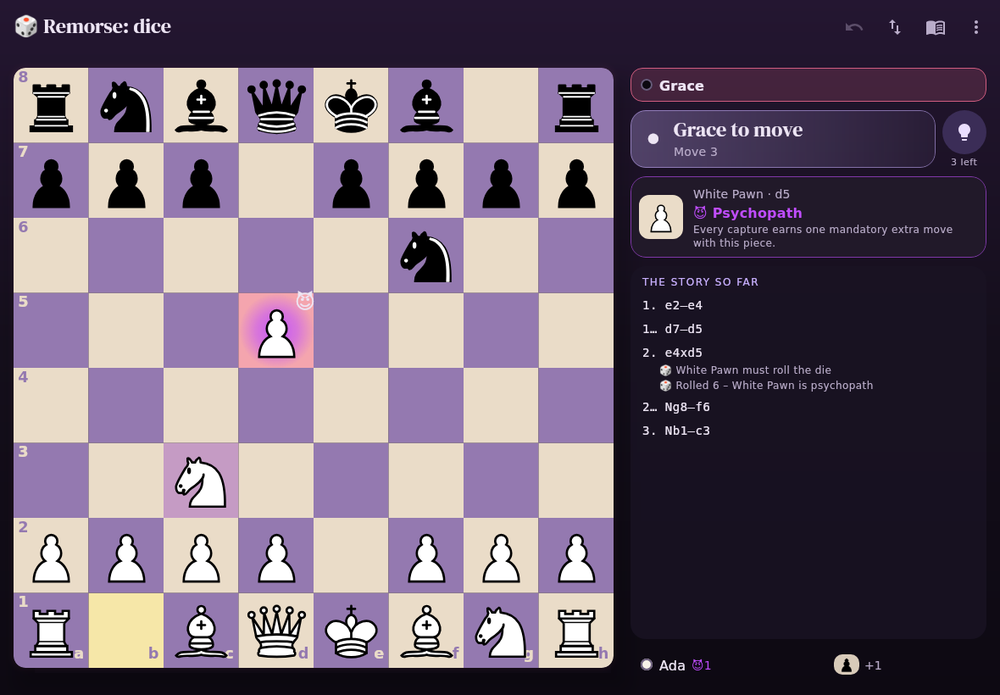
  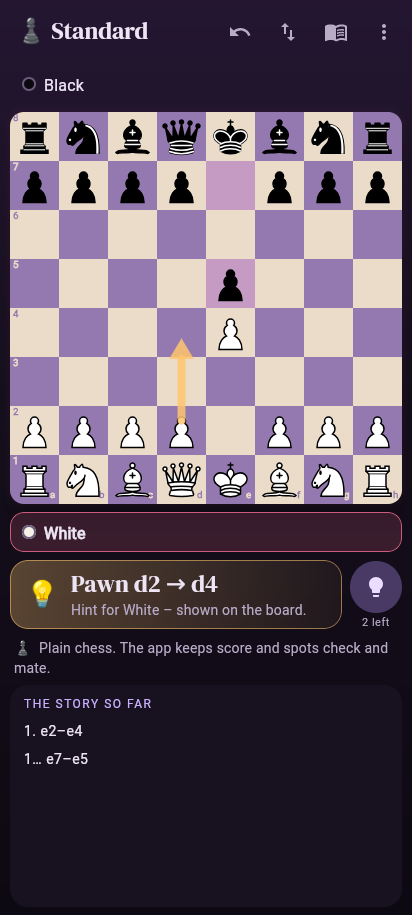

Play against a friend on **one device**, **online from two browsers** (anywhere), or on **two Android
phones in the same room**. Saves stay on the device: a file on Android, the browser's storage on the web.

  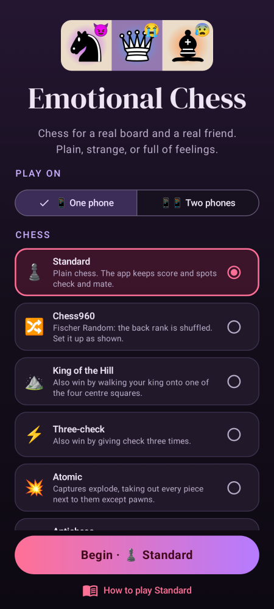
  
  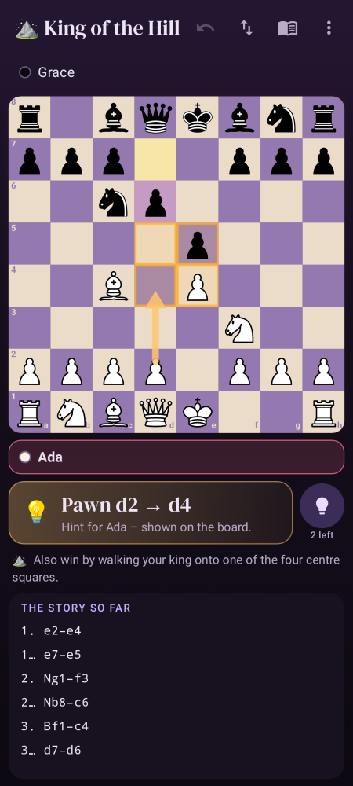

## Modes

Every mode plays with one standard set on a standard board.

**Chess**

| Mode | Twist |
|---|---|
| ♟️ Standard | Plain chess: check, mate, stalemate, castling, en passant, promotion, repetition and 50-move draws. |
| 🔀 Chess960 | Shuffled back rank (shown in the app – set your board up to match). Castle by tapping the king, then the rook. |
| ⛰️ King of the Hill | Also win by moving your king onto d4, e4, d5 or e5. |
| ⚡ Three-check | Also win by giving check three times. |
| 💥 Atomic | Captures explode: capturer, victim and every non-pawn around them leave the board. Kings can't capture. |
| 🙃 Antichess | Captures are forced, no check, the king is just a piece. Lose all your pieces (or get stalemated) to win. |
| 🏁 Racing Kings | No pawns, no checks allowed. First king to the 8th rank wins. |

**Feelings & mayhem**

| Mode | Twist |
|---|---|
| 🎲 Remorse: dice | A piece's first capture rolls a die: 😭 devastated (1), 😰 guilt-ridden (2–3), 😌 unaffected (4–5), 😈 psychopath (6). |
| ✝️ Remorse: classic | Every capture makes the piece remorseful 😔: it can't capture or give check until a bishop forgives it. |
| 🦠 Plague | Capturing infects 🤢. Sick pieces spread it to every healthy piece next to where they move, and die after five turns unless a bishop cures them 💉 (then they're immune 💪). |
| ⭐ Roguelike | Every capture levels a piece up: pick one of three perks – 🐴 Leap, 🏰 Charge, ⛪ Slant, 👣 Step or 🛡️ Shield. |

**Bishops heal themselves.** In both remorse modes an afflicted bishop can spend its turn absolving or
forgiving itself (a house rule; the published remorse rules don't allow it). In Plague, bishops are the
doctors and never fall ill.

Remorse (dice) in detail

| Roll | Mood | Effect |
|---|---|---|
| 1 | 😭 Devastated | Frozen, gives no check, leaves the board after its owner's 3rd following turn unless absolved. A departing king loses. |
| 2–3 | 😰 Guilt-ridden | Moves normally, cannot capture or give check until absolved. |
| 4–5 | 😌 Unaffected | Nothing happens. |
| 6 | 😈 Psychopath | Every later capture earns one mandatory extra move; that extra move may capture the king. |

Absolution takes a whole turn: a friendly, non-devastated bishop next to the afflicted piece absolves it
(never while in check). Roll a real die and tap the face, or let the app roll. Rules follow nabous.dev
(classic) and remorsechess.com (dice).

  
  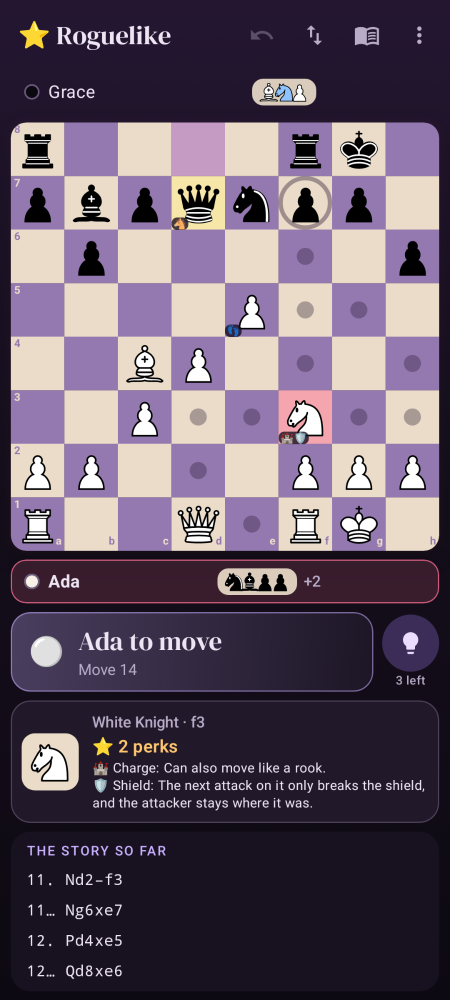
  

  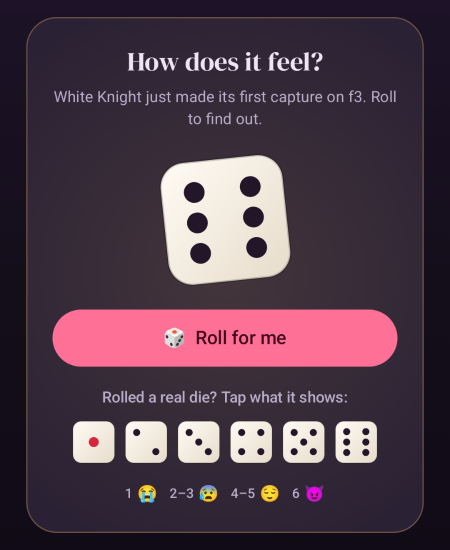
  
  

## Online (website)

Each player uses their own browser – phone or computer, anywhere.

1. One player chooses **Online**, picks the mode, their side and hints, and taps **Host**.
2. The website shows a 5-letter room code and an invitation link (**Share the invitation link**).
3. The friend opens the link (or chooses **Online**, types the code and taps **Join room …**).

The two browsers talk directly over WebRTC; the free public [PeerJS](https://peerjs.com) server only
introduces them, so there is no account and nothing to run. Phones often reload a page in the
background (for example while you send the link): the page remembers its room, the host reopens the
same room, and the guest finds it again. Some strict networks block direct connections; if joining
fails, try another network (for example both on Wi-Fi).

  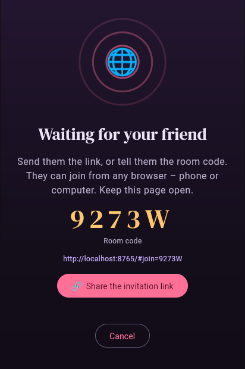
  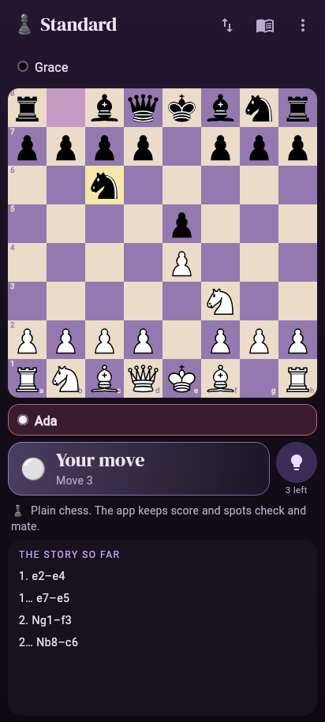
  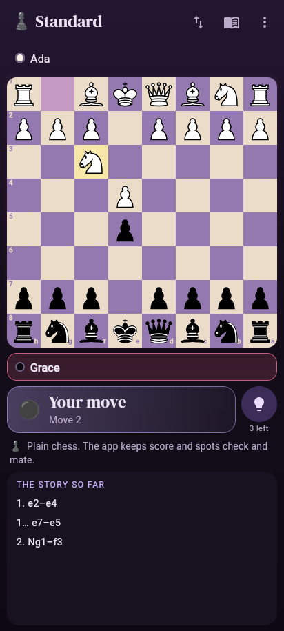

## Two Android phones in the same room

Each player can use their own phone. The phones link directly over Bluetooth / Wi-Fi in the same room
(Google Nearby Connections), with no account and no server.

1. Both players choose **Two phones** on the start screen.
2. One taps **Host** (after picking the mode, their side and hints); the other taps **Join a friend's game**
   and picks the host from the list.
3. Both phones show the same 4-digit code; the host checks it and lets their friend in.

Online and on two phones alike, each device only lets its own player move; dice rolls, perk picks,
hints, draw offers and resignations reach the other one. Every move carries a checksum of the resulting game, and if the phones ever
disagree the host's game wins and is resent. If the connection drops, both phones look for each other
again and carry on; or tap **Keep playing on this phone** to finish the game on one phone. There is no
undo between phones. Needs Google Play services and the Nearby devices permission.

  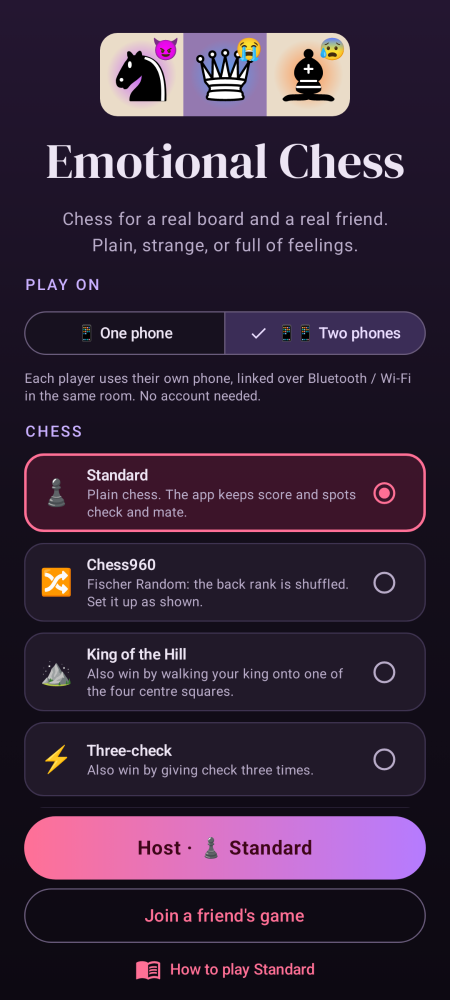
  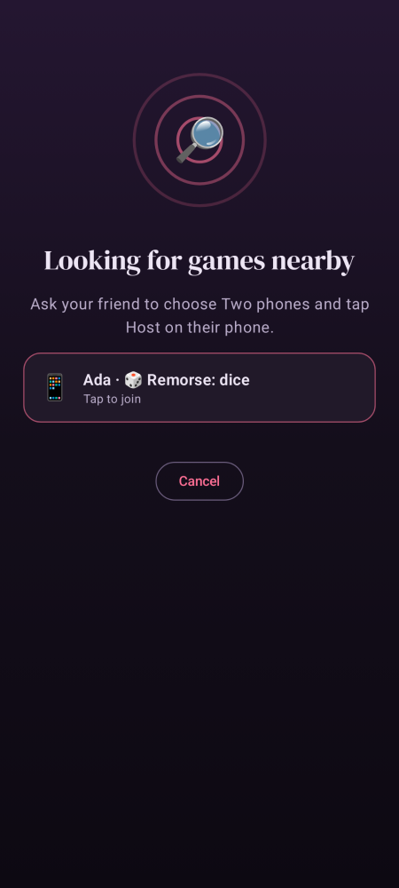
  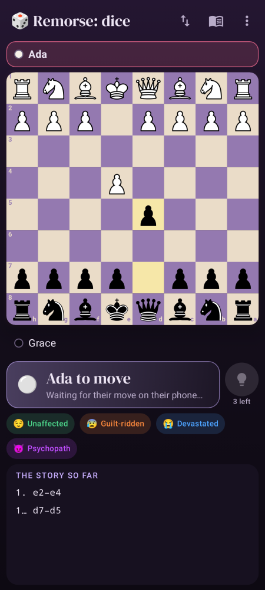

## Features

- **Hints.** A built-in engine (iterative-deepening alpha-beta on top of the app's own rules, so it
  understands every mode, including dice odds and perks) suggests a move and draws it as an arrow.
  Choose Off, 3 per player, or unlimited when you start.
- **Feelings you can see.** Afflicted pieces glow in their mood's colour and wear it as an emoji;
  psychopaths pulse, devastated pieces shiver, the dying carry a countdown badge, perks sit under the piece.
- **Pieces that move.** Pieces slide, captured pieces fade, atomic captures explode, check pulses red,
  and goal squares (the hill, the finish line) are marked in gold.
- **Player bars** with captured pieces, material balance, mood counts and three-check counters.
- **An end-of-game report:** captures, checks, absolutions and cures, losses to despair or plague, perks,
  and every roll, per player.
- Undo, board flip, resign/draw, automatic save, screen kept on, haptics.
- Built for the Pixel Fold: stacked on the outer screen, side by side when unfolded.

## Building

The code lives in one module, `app`: rules, hint engine, two-phone protocol and all screens in
`src/commonMain`; small per-platform pieces (Nearby, permissions, haptics, saving, fonts) in
`src/androidMain`, `src/desktopMain` and `src/wasmJsMain`.

| Target | Command (JDK 17+) |
|---|---|
| Android APK | `./gradlew assembleDebug` (Android SDK 35) |
| Desktop window, for quick local testing | `./gradlew :app:run` |
| Web | `./gradlew :app:wasmJsBrowserDistribution` → `app/build/dist/wasmJs/productionExecutable`; try it with `./gradlew :app:wasmJsBrowserDevelopmentRun` |
| Tests | `./gradlew testDebugUnitTest :app:desktopTest` |

After adding an emoji or symbol to any text, run `python3 tools/subset_web_fonts.py <NotoColorEmoji.ttf>
<DejaVuSans.ttf>` so the website's small fonts include it.

GitHub Actions builds and tests the Android app and the website on every push (`.github/workflows/`).

The move generator is checked against published perft counts, every mode has rule tests, the hint
engine is tested on mates, free material and every mode, and two-phone play is tested end to end with
two app instances on an in-memory link (joining, moves, dice, perks, hints, draws, resyncs, dropped
connections). The screenshots above are rendered on the JVM by
[Paparazzi](https://github.com/cashapp/paparazzi) (`app/src/androidUnitTest/kotlin/com/emotionalchess/ui/Screenshots.kt`);
`./gradlew recordPaparazziDebug` regenerates them. The desktop app is rendered off-screen by
`app/src/desktopTest`, into `app/build/desktop-shots/`.

## Credits

- Chess pieces: the "cburnett" set by Colin M.L. Burnett, from Wikimedia Commons, used under the BSD licence
  (the set is triple-licensed GFDL/BSD/GPL).
- Display font: [DM Serif Display](https://fonts.google.com/specimen/DM+Serif+Display), SIL Open Font Licence
  (`licenses/DMSerifDisplay-OFL.txt`).
- Web build only: a subset of [Noto Color Emoji](https://github.com/googlefonts/noto-emoji) (SIL Open Font
  Licence, `licenses/NotoColorEmoji-LICENSE.txt`) and eight punctuation marks from DejaVu Sans
  (`licenses/DejaVu-LICENSE.txt`), because a browser canvas has no system fonts.
- Seven Material icons (Apache 2.0), copied into `AppIcons.kt`.
- Online play: [PeerJS](https://github.com/peers/peerjs) (MIT) and its free public server.
