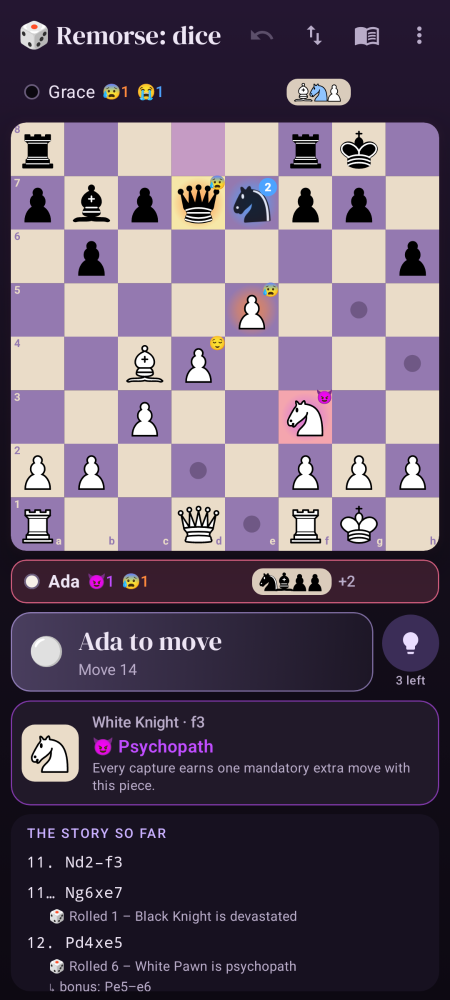
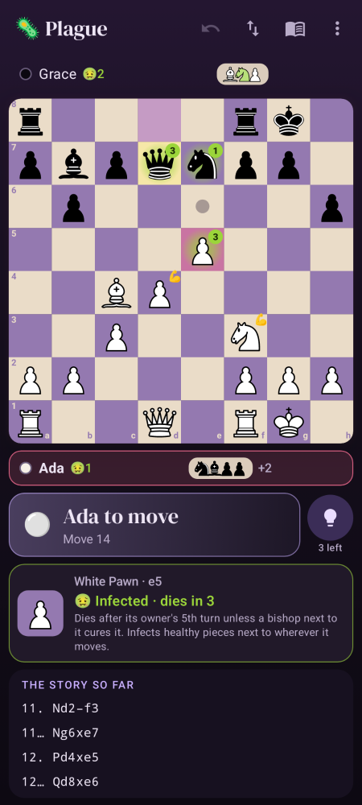
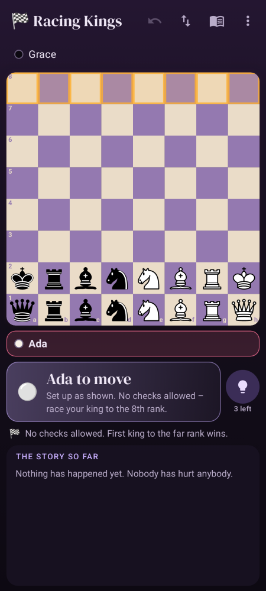
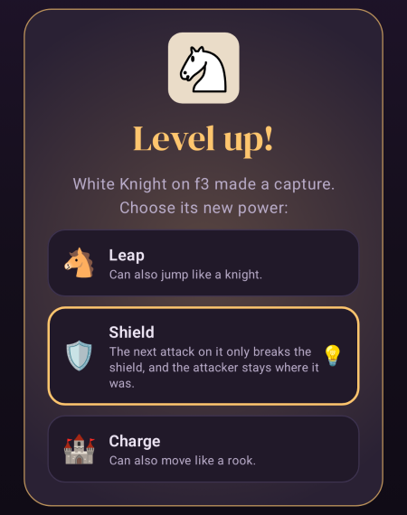
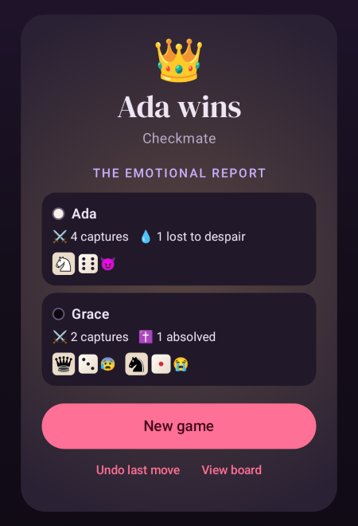
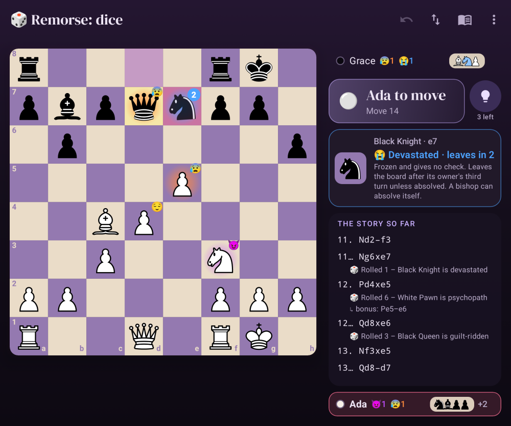

# Emotional Chess

An Android companion for playing chess **on a real board** with a friend: plain chess, six well-known
variants, and four modes where the pieces have feelings, diseases and powers. Mirror each move on the
phone. The app knows the rules of every mode, shows what each piece may do, keeps track of everything
you can't see on the physical board, and can suggest a move when you're stuck.

  
  
  

## Modes

Every mode plays with one standard set on a standard board.

**Chess**

| Mode | Twist |
|---|---|
| ♟️ Standard | Plain chess: check, mate, stalemate, castling, en passant, promotion, repetition and 50-move draws. |
| 🔀 Chess960 | Shuffled back rank (shown in the app – set your board up to match). Castle by tapping the king, then the rook. |
| ⛰️ King of the Hill | Also win by moving your king onto d4, e4, d5 or e5. |
| ⚡ Three-check | Also win by giving check three times. |
| 💥 Atomic | Captures explode: capturer, victim and every non-pawn around them leave the board. Kings can't capture. |
| 🙃 Antichess | Captures are forced, no check, the king is just a piece. Lose all your pieces (or get stalemated) to win. |
| 🏁 Racing Kings | No pawns, no checks allowed. First king to the 8th rank wins. |

**Feelings & mayhem**

| Mode | Twist |
|---|---|
| 🎲 Remorse: dice | A piece's first capture rolls a die: 😭 devastated (1), 😰 guilt-ridden (2–3), 😌 unaffected (4–5), 😈 psychopath (6). |
| ✝️ Remorse: classic | Every capture makes the piece remorseful 😔: it can't capture or give check until a bishop forgives it. |
| 🦠 Plague | Capturing infects 🤢. Sick pieces spread it to every healthy piece next to where they move, and die after five turns unless a bishop cures them 💉 (then they're immune 💪). |
| ⭐ Roguelike | Every capture levels a piece up: pick one of three perks – 🐴 Leap, 🏰 Charge, ⛪ Slant, 👣 Step or 🛡️ Shield. |

**Bishops heal themselves.** In both remorse modes an afflicted bishop can spend its turn absolving or
forgiving itself (a house rule; the published remorse rules don't allow it). In Plague, bishops are the
doctors and never fall ill.

Remorse (dice) in detail

| Roll | Mood | Effect |
|---|---|---|
| 1 | 😭 Devastated | Frozen, gives no check, leaves the board after its owner's 3rd following turn unless absolved. A departing king loses. |
| 2–3 | 😰 Guilt-ridden | Moves normally, cannot capture or give check until absolved. |
| 4–5 | 😌 Unaffected | Nothing happens. |
| 6 | 😈 Psychopath | Every later capture earns one mandatory extra move; that extra move may capture the king. |

Absolution takes a whole turn: a friendly, non-devastated bishop next to the afflicted piece absolves it
(never while in check). Roll a real die and tap the face, or let the app roll. Rules follow nabous.dev
(classic) and remorsechess.com (dice).

  
  
  

  
  
  

## Features

- **Hints.** A built-in engine (iterative-deepening alpha-beta on top of the app's own rules, so it
  understands every mode, including dice odds and perks) suggests a move and draws it as an arrow.
  Choose Off, 3 per player, or unlimited when you start.
- **Feelings you can see.** Afflicted pieces glow in their mood's colour and wear it as an emoji;
  psychopaths pulse, devastated pieces shiver, the dying carry a countdown badge, perks sit under the piece.
- **Pieces that move.** Pieces slide, captured pieces fade, atomic captures explode, check pulses red,
  and goal squares (the hill, the finish line) are marked in gold.
- **Player bars** with captured pieces, material balance, mood counts and three-check counters.
- **An end-of-game report:** captures, checks, absolutions and cures, losses to despair or plague, perks,
  and every roll, per player.
- Undo, board flip, resign/draw, automatic save, screen kept on, haptics.
- Built for the Pixel Fold: stacked on the outer screen, side by side when unfolded.

## Building

GitHub Actions (`.github/workflows/android.yml`) runs the unit tests and builds a debug APK on every push.
Download it from the run's **Artifacts** section (`emotional-chess-debug-apk`) and install it on the phone.

Locally: `./gradlew testDebugUnitTest assembleDebug` (JDK 17+, Android SDK 35).

The move generator is checked against published perft counts, every mode has rule tests, and the hint
engine is tested on mates, free material and every mode. The screenshots above are rendered on the JVM by
[Paparazzi](https://github.com/cashapp/paparazzi) (`app/src/test/java/com/emotionalchess/ui/Screenshots.kt`);
`./gradlew recordPaparazziDebug` regenerates them into `app/src/test/snapshots/images/`.

## Credits

- Chess pieces: the "cburnett" set by Colin M.L. Burnett, from Wikimedia Commons, used under the BSD licence
  (the set is triple-licensed GFDL/BSD/GPL).
- Display font: [DM Serif Display](https://fonts.google.com/specimen/DM+Serif+Display), SIL Open Font Licence
  (`licenses/DMSerifDisplay-OFL.txt`).
