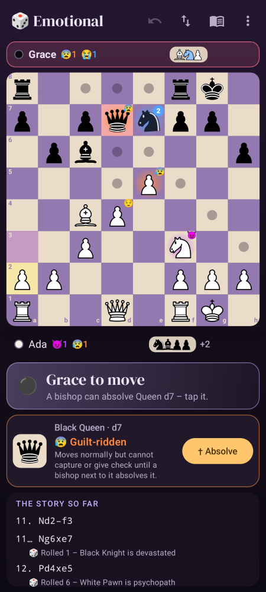
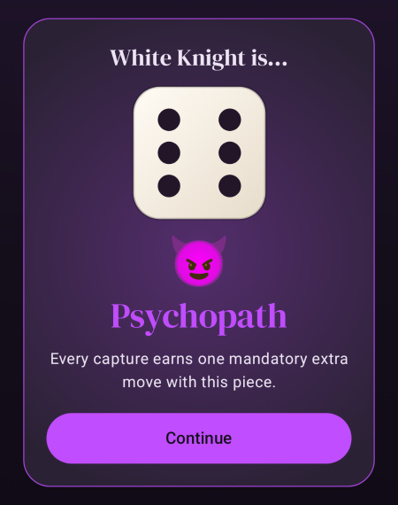

# Emotional Chess

An Android companion app for playing **Remorse Chess** (a.k.a. emotional chess) on a real board with a friend.
Mirror each move on the phone. The app keeps track of how every piece feels — die rolls, guilt, despair
countdowns, psychopaths and absolutions — and enforces what each piece may still do.

  
  
  

  
  
  

## Variants

**Emotional (dice)** – a piece's first capture rolls one die:

| Roll | Mood | Effect |
|---|---|---|
| 1 | 😭 Devastated | Frozen, gives no check, leaves the board after its owner's 3rd following turn unless absolved. A departing king loses. |
| 2–3 | 😰 Guilt-ridden | Moves normally, cannot capture or give check until absolved. |
| 4–5 | 😌 Unaffected | Nothing happens. |
| 6 | 😈 Psychopath | Every later capture earns one mandatory extra move; that extra move may capture the king. |

Absolution takes a whole turn: a friendly, non-devastated bishop next to the afflicted piece absolves it
(never itself, never while in check). Roll a real die and tap the face, or let the app roll.

**Classic Remorse** – a piece that captures becomes remorseful 😔: it can move and block but cannot capture
(and so gives no check) until a friendly bishop moves onto one of the eight squares around it.

Rules follow the published descriptions at nabous.dev (classic) and remorsechess.com (dice).

## Features

- **Feelings you can see.** Afflicted pieces glow in their mood's colour and wear it as an emoji; psychopaths
  pulse, devastated pieces shiver with a countdown badge.
- **A die worth rolling.** The die tumbles and lands with a buzz, then reveals the piece's fate. Physical rolls
  are entered by tapping a die face.
- **Pieces that move.** Pieces slide to their new squares, captured pieces fade away, check pulses red, and the
  pieces that can be absolved glow gold.
- **Player bars** with captured pieces (despair losses tinted blue), material balance and each side's moods.
- **An emotional report** at the end: captures, absolutions, losses to despair and every roll, per player.
- Legal-move highlighting, check/checkmate/stalemate, castling, en passant, promotion, repetition and 50-move draws.
- Undo, board flip, resign/draw, automatic save, screen kept on, haptics.
- Built for the Pixel Fold: stacked on the outer screen, side by side when unfolded.

## Building

GitHub Actions (`.github/workflows/android.yml`) runs the unit tests and builds a debug APK on every push.
Download it from the run's **Artifacts** section (`emotional-chess-debug-apk`) and install it on the phone.

Locally: `./gradlew testDebugUnitTest assembleDebug` (JDK 17+, Android SDK 35).

The screenshots above are rendered on the JVM by [Paparazzi](https://github.com/cashapp/paparazzi)
(`app/src/test/java/com/emotionalchess/ui/Screenshots.kt`). Run `./gradlew recordPaparazziDebug` to regenerate
them into `app/src/test/snapshots/images/`.

## Credits

- Chess pieces: the "cburnett" set by Colin M.L. Burnett, from Wikimedia Commons, used under the BSD licence
  (the set is triple-licensed GFDL/BSD/GPL).
- Display font: [DM Serif Display](https://fonts.google.com/specimen/DM+Serif+Display), SIL Open Font Licence
  (`licenses/DMSerifDisplay-OFL.txt`).
